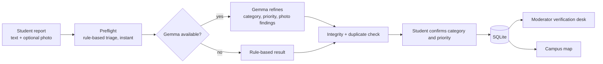

# VU CampusFix

**Turn student-reported campus problems into clear, structured reports that maintenance staff can act on.**

Students describe a problem (text, optionally a photo). CampusFix triages it, flags safety concerns, spots likely duplicates, pins it on a campus map and hands moderators a verification desk. It runs without an AI model, but can use Ollama and Gemma for richer analysis.


## Before and after

A raw message goes in:

> *exposed wire sparking near the lab door again, pls fix asap*  (Labs & Workshops · Ground floor, lab corridor)

A triaged ticket comes out (real output from the built-in rule-based triage, no AI model needed):

| Field | Result |
|---|---|
| Title | Electrical hazard |
| Category / priority | Electrical · **Urgent** |
| Suggested team | Electrical maintenance |
| Recommended response | Keep away from the area; alert campus security and a qualified electrician. |
| Safety note | Treat as potentially hazardous until campus staff review. |
| Evidence quality | 66/100 · *Needs human verification* |

With Ollama and Gemma running, the same pipeline also reads attached photos and writes richer observations.


## Features

- **AI-assisted triage**: 15 categories, 4 priority levels, recommended action and responsible team.
- **Works without AI**: if Ollama or the model is missing, a rule-based fallback keeps the app useful. Photos are only analysed when Gemma is available.
- **Honest scoring**: the evidence score measures how complete a report is, *not* whether it is true. The app never auto-rejects a report; a human decides.
- **Duplicate hints**: similar open reports are surfaced, because a duplicate often means a real recurring problem.
- **Verification desk** for moderators, with a required reason before anything is marked a possible prank.
- **Editable campus map** with report pins that cluster per building.
- **Audit trail** of every moderator action.
- **Abuse protection**: per-IP rate limits, image validation, size limits, and a lock-out after repeated wrong moderator tokens.


## Quick start (Windows)

1. Install [Python 3.10+](https://www.python.org/downloads/windows/) and tick **Add python.exe to PATH**.
2. Double-click **`Start_CampusFix_Demo.bat`** (sample reports) or **`Start_CampusFix.bat`** (empty).
3. Your browser opens. The terminal prints a **moderator token**. Keep the window open.

macOS / Linux:

```bash
cp .env.example .env
python3 app/campusfix_vu.py
```

### Optional: local AI

1. Install [Ollama](https://ollama.com/download).
2. Run `Download_Gemma4.bat` (or `ollama pull gemma4:e4b`). The download is several GB.
3. Restart CampusFix. The top bar changes from *AI setup needed* to *Gemma ready*.

## Who can do what

| | Public visitor | Moderator |
|---|:---:|:---:|
| View dashboard, register, map | ✅ | ✅ |
| Submit a report and run AI triage | ✅ (rate-limited) | ✅ |
| See staff notes and who verified a report | ❌ | ✅ |
| Change status, verify, assign, delete reports | ❌ | ✅ |
| Add, move, rename, delete or reset map zones | ❌ | ✅ |
| Read the audit log | ❌ | ✅ |

Click **Moderator** in the sidebar and paste the token. Set your own with `ADMIN_TOKEN` in `.env`; otherwise a random one is generated on first run and saved to `data/.admin_token`. Reporter identity is not exposed to public visitors.

### Sharing on your network

`Start_CampusFix_LAN.bat` makes the app reachable from other devices on the same Wi-Fi. Visitors can view and report; only people with the token can moderate. For internet access, deploy behind HTTPS and use appropriate production hardening.

### Demo mode

`UNRESTRICTED_MODE=true` makes **everyone** a moderator. It exists for throw-away local demos only and prints a warning at startup. Do not use it with real reports.

## How it works



## Project layout

```
app/
  campusfix_vu.py        HTTP server, API, database, moderator sessions
  campusfix_engine.py    triage rules, Gemma client, duplicate detection
  static/                index.html (UI) and the VU logo
tests/test_smoke.py      end-to-end tests (no dependencies)
docs/                    screenshots
.env.example             configuration template
Start_CampusFix*.bat     Windows launchers
```

## API

Public: `GET /api/health` · `/api/reports` · `/api/reports/<id>` · `/api/places` · `/api/map` · `POST /api/reports/preflight` · `/api/reports/analyze` · `/api/reports`

Moderator (cookie session from `POST /api/auth/admin`): `PATCH`/`DELETE /api/reports/<id>` · `POST /api/places` · `PATCH`/`DELETE /api/places/<id>` · `POST /api/places/reset` · `GET /api/audit`

## Tests

```bash
python -m unittest discover -s tests -v
```

The suite starts a real server on a free port with a temporary database and checks the public/moderator permission split, privacy of staff fields, validation, rate limits and lock-out.

## Configuration

See [`.env.example`](.env.example). The most useful settings: `ADMIN_TOKEN`, `CAMPUSFIX_DEMO_DATA`, `OLLAMA_MODEL`, `HOST`, `PORT`.

## Limitations

- The campus map is a **schematic with placeholder positions**, not an official VU map. Calibrate it before using it for navigation.
- AI output is advisory. Safety-related reports should still be raised with campus security directly.
- Rate limits are per IP and kept in memory (reset on restart). Fine for a campus pilot, not a substitute for production hardening.
- SQLite storage with base64 photos suits a pilot; a larger deployment should move images to file storage.

## Ideas for next steps

Email or Telegram alerts for Urgent reports, a mobile "add to home screen" manifest, CSV export for facilities teams, per-team moderator accounts, and a calibrated VU campus plan.

## License

[MIT](LICENSE) © 2026 Shreshtha Jagdambe
